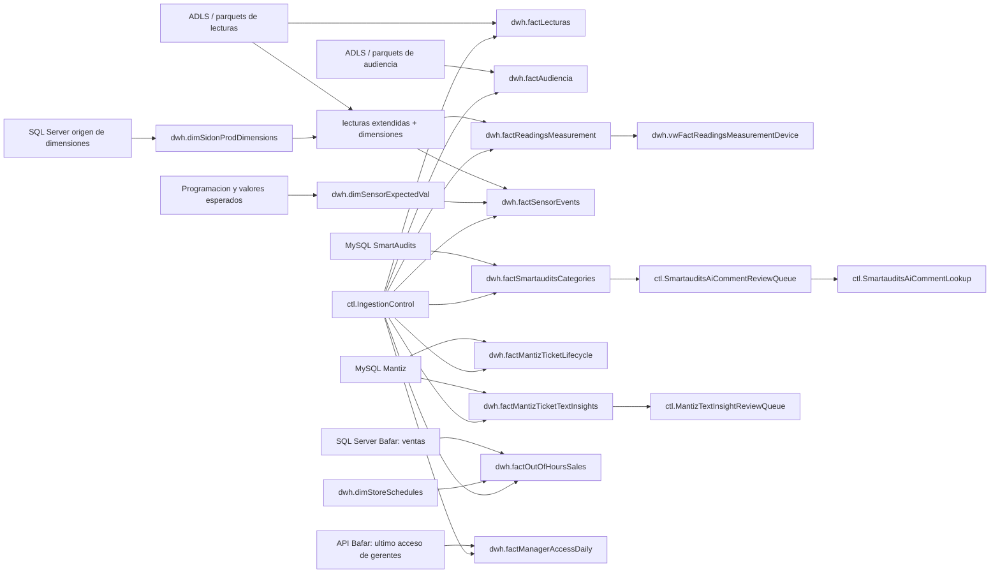

# Flujo de datos

## Vista general

## Sense

El flujo Sense parte de datos crudos en parquet. `dwh.factLecturas` conserva lecturas de sensores para corroboraciones especificas y consultas ad hoc. En CarlsJr, `dwh.factAudiencia` conserva eventos de audiencia provenientes de la raiz `audience`. Las mediciones operativas se construyen desde lecturas del data lake enriquecidas con `dwh.dimSidonProdDimensions`.

## Eventos de sensores

`dwh.factSensorEvents` se alimenta desde lecturas extendidas. Los eventos de presencia detectan cambios de estado por sensor. Los eventos de temperatura comparan lecturas contra `dwh.dimSensorExpectedVal` y solo conservan periodos fuera de rango con duracion suficiente.

## SmartAudits

SmartAudits lee cambios en `plan_results` y `evidence_photos`, cruza contexto de tareas, checkpoints, ubicaciones, usuarios, prioridades y categorias, y consolida el resultado en `dwh.factSmartauditsCategories`. Los comentarios no resueltos o de baja confianza se envian a `ctl.SmartauditsAiCommentReviewQueue`.

## Mantiz

Mantiz tiene dos salidas principales. `dwh.factMantizTicketLifecycle` modela el estado y tiempos del ciclo de vida del ticket. `dwh.factMantizTicketTextInsights` extrae fallas, soluciones y refacciones desde textos de tickets y comentarios; los conceptos nuevos o ambiguos se envian a `ctl.MantizTextInsightReviewQueue`.

## Ventas fuera de horario Bafar

El flujo Bafar lee ventas incrementales, las compara contra `dwh.dimStoreSchedules` y conserva en `dwh.factOutOfHoursSales` las ventas antes de apertura, durante comida, despues de cierre o sin horario aplicable. El watermark `FactOutOfHoursSales` solo se actualiza al completar la corrida.

## Acceso de gerentes Bafar

El flujo consulta diariamente la API de ultimo acceso con una fecha y hora de corte explicitas, valida el contrato completo y consolida la snapshot en `dwh.factManagerAccessDaily`. El watermark `FactManagerAccessDaily` solo avanza al completar la carga; los backfills diarios aplican el mismo upsert sin modificarlo.
