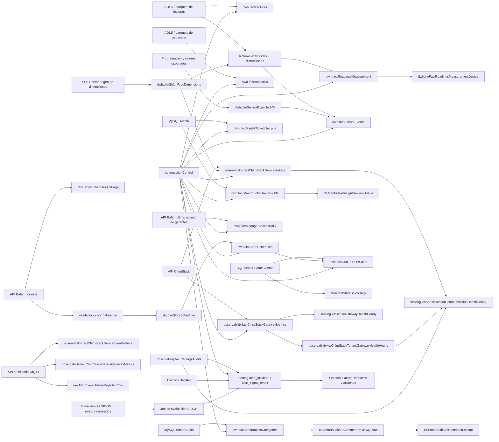

# Flujo de datos

## Vista general

## Sense

El flujo Sense parte de datos crudos en parquet. `dwh.factLecturas` conserva lecturas de sensores para corroboraciones especificas y consultas ad hoc. En CarlsJr, `dwh.factAudiencia` conserva eventos de audiencia provenientes de la raiz `audience`. Las mediciones operativas se construyen desde lecturas del data lake enriquecidas con `dwh.dimSidonProdDimensions`.

## Eventos de sensores

`dwh.factSensorEvents` se alimenta desde lecturas extendidas. Los eventos de presencia detectan cambios de estado por sensor. Los eventos de temperatura comparan lecturas contra `dwh.dimSensorExpectedVal` y solo conservan periodos fuera de rango con duracion suficiente.

## SmartAudits

SmartAudits lee cambios en `plan_results` y `evidence_photos`, cruza contexto de tareas, checkpoints, ubicaciones, usuarios, prioridades y categorias, y consolida el resultado en `dwh.factSmartauditsCategories`. Los comentarios no resueltos o de baja confianza se envian a `ctl.SmartauditsAiCommentReviewQueue`.

## Mantiz

Mantiz tiene dos salidas principales. `dwh.factMantizTicketLifecycle` modela el estado y tiempos del ciclo de vida del ticket. `dwh.factMantizTicketTextInsights` extrae fallas, soluciones y refacciones desde textos de tickets y comentarios; los conceptos nuevos o ambiguos se envian a `ctl.MantizTextInsightReviewQueue`.

Mantiz está desactivado. Sus nodos representan el diseño conservado, no un flujo activo.

## Ventas fuera de horario Bafar

Los horarios se obtienen desde la API Bafar a las 10:00 y 22:00 en `America/Ciudad_Juarez`. Cada pagina se conserva en `raw.StoreSchedulesApiPage` antes de validarse, la corrida completa se normaliza en `stg.dimStoreSchedules` y el `MERGE` conserva en `dwh.dimStoreSchedules` el ultimo horario valido por sucursal y dia. Un fallo previo al `MERGE` no modifica los horarios vigentes.

El flujo de ventas lee datos incrementales, los compara contra `dwh.dimStoreSchedules` y conserva en `dwh.factOutOfHoursSales` las ventas antes de apertura, durante comida, despues de cierre o sin horario aplicable. El watermark `FactOutOfHoursSales` solo se actualiza al completar la corrida.

## Acceso de gerentes Bafar

El flujo consulta diariamente la API de ultimo acceso con fecha, hora de corte y ventana historica explicitas, valida el contrato completo v1.1 y consolida la snapshot gerente-sucursal en `dwh.factManagerAccessDaily`. El watermark `FactManagerAccessDaily` solo avanza al completar la carga; los backfills diarios aplican el mismo upsert sin modificarlo.

## Observabilidad ChirpStack

Carl's Jr., Emerson y Valle del Encino consultan la ultima hora UTC cerrada de ChirpStack. `PhysicalIdentifier` define el alcance de devices; la API resuelve aplicaciones, perfiles, tenants y gateways sin identificadores configurados manualmente. El asset oficial consolida los hechos de devices y gateways dentro de una misma transacción y las vistas de serving integran uplinks, RSSI, SNR, errores, bateria, estado oficial del gateway y lecturas DATA.

Los DDLs son compartidos en `sql/init`. El code location `bafar` elimina estos objetos en su init especifico porque no ejecuta el pipeline.

Los hechos MQTT se consolidan desde un asset distinto al de métricas oficiales y comparten una decisión de aceptación por dispositivo y hora. Los rechazos individuales tienen retención acotada. Véase el [pipeline](../pipelines/chirpstack_observability.md).

## Señales de alertamiento

Cada tenant detecta condiciones desde auditorías, control de ingesta y eventos Dagster, y escribe incidencias y señales `DETECTED`/`CLEARED`. Carlsjr, Emerson y Valle también evalúan configuración SIDON mediante un job por entidad. El sistema externo administra workflow y acciones según los [contratos de alertamiento](../data_model/alerting.md); Dagster no entrega correo.
