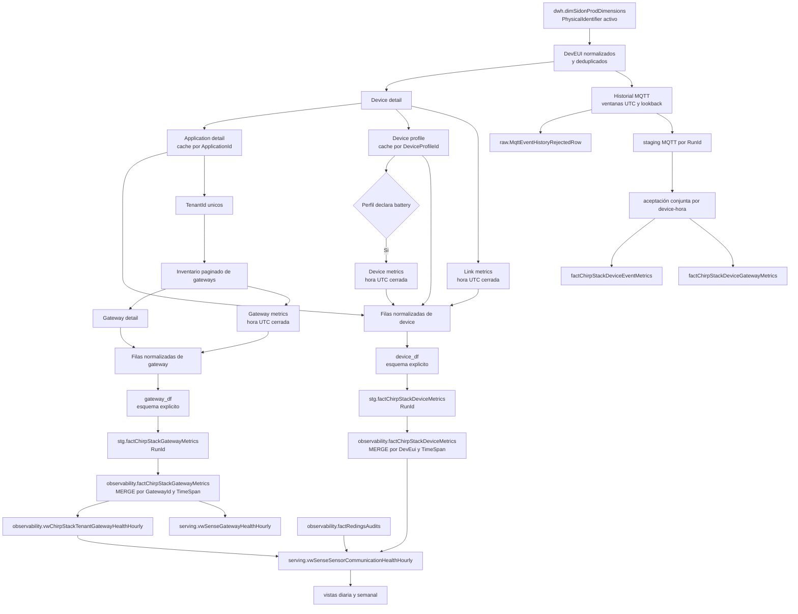

# Pipeline `023_sense_chirpstack_metrics`

## Proposito

Materializar evidencia horaria de devices y gateways de ChirpStack para distinguir falta de comunicacion, degradacion del enlace, problemas de gateway y problemas de ingestion hacia DATA.

## User codes

- `carlsjr`
- `emerson`
- `valledelencino`
- `ecosat`

El code location `bafar` no ejecuta este pipeline y elimina estos contratos durante su inicializacion SQL especifica.

## Entradas

- `dwh.dimSidonProdDimensions.PhysicalIdentifier` como `DevEui`.
- API de devices, aplicaciones, perfiles, link metrics y device metrics de ChirpStack.
- API de inventario, detalle y metricas de gateways de ChirpStack.
- API de historial de eventos MQTT para `carlsjr`, `emerson`, `valledelencino` y `ecosat`.
- `observability.factRedingsAudits` para la integracion posterior en vistas de serving.

## Salidas

- `observability.factChirpStackDeviceMetrics`.
- `observability.factChirpStackGatewayMetrics`.
- `observability.factChirpStackDeviceEventMetrics`.
- `observability.factChirpStackDeviceGatewayMetrics`.
- `raw.MqttEventHistoryRejectedRow` para filas de la API MQTT que no cumplen el contrato.
- Vistas horarias de comunicacion de sensores y salud de gateways.
- Vistas diaria y semanal de comunicacion de sensores.
- Watermark `factChirpStackMetrics` en `ctl.IngestionControl`.

## Programacion

- Job: `023_sense_chirpstack_metrics`.
- Schedule: `023_sense_chirpstack_metrics_hourly_at_30`, una vez por hora al minuto 30.
- Frecuencia: una vez por hora al minuto 30.
- Zona horaria: `America/Ciudad_Juarez`.
- Estado inicial: activo en `carlsjr` y `emerson`; detenido en `valledelencino` y `ecosat`.

## Flujo

1. Calcula la ultima hora UTC cerrada.
2. Lee dimensiones activas con `PhysicalIdentifier`.
3. Normaliza y deduplica los `DevEui`.
4. Resuelve `ApplicationId`, `DeviceProfileId` y `TenantId` desde ChirpStack.
5. Obtiene uplinks, RSSI, SNR, errores y bateria disponible por device.
6. Obtiene inventario, estado oficial y metricas horarias de gateways por tenant.
7. Consulta la API de historial MQTT y extrae uplinks, logs y `rxInfo[]`.
8. Construye DataFrames con esquemas explicitos.
9. Escribe los hechos disponibles en staging por `RunId`.
10. Ejecuta los `MERGE` oficiales en una transacción; el asset MQTT utiliza otra consolidación transaccional con una decisión común de aceptación de snapshots para sus dos hechos.
11. Limpia staging y actualiza el watermark si la corrida termina correctamente.

## Contrato HTTP

Todas las consultas usan `GET`, no envian body y se construyen sobre `CHIRPSTACK_API_URL`. Cada request incluye:

- `Accept: application/json`.
- `Grpc-Metadata-Authorization: Bearer <CHIRPSTACK_API_TOKEN>`.
- timeout configurado mediante `CHIRPSTACK_API_TIMEOUT_SECONDS`.

Las ventanas se expresan en UTC con formato RFC 3339, precision de segundos y sufijo `Z`. Para metricas se envia siempre `aggregation=HOUR`.

## Endpoints consultados

| Endpoint | Proposito | Parametros | Datos consumidos | Destino |
|---|---|---|---|---|
| `GET /api/devices/{devEui}` | Resolver y validar el device asociado con `PhysicalIdentifier` | path: `devEui` normalizado | `devEui`, `applicationId`, `deviceProfileId`, `deviceStatus` | fila de device |
| `GET /api/applications/{applicationId}` | Resolver el tenant del device | path: `applicationId` obtenido del device | `application.id`, `application.tenantId` | fila de device y alcance de gateways |
| `GET /api/device-profiles/{deviceProfileId}` | Obtener la periodicidad esperada y detectar soporte de bateria | path: `deviceProfileId` obtenido del device | `deviceProfile.id`, `tenantId`, `uplinkInterval`, `measurements` | fila de device |
| `GET /api/devices/{devEui}/link-metrics` | Obtener recepcion y calidad del enlace durante la hora cerrada | query: `start`, `end`, `aggregation=HOUR` | timestamps, uplinks, RSSI, SNR y errores | fila de device |
| `GET /api/devices/{devEui}/metrics` | Obtener bateria cuando el perfil declara esa medicion | query: `start`, `end`, `aggregation=HOUR` | serie `battery` | fila de device |
| `GET /api/gateways` | Construir el inventario de gateways de cada tenant descubierto | query: `limit`, `offset`, `tenantId` | `totalCount`, `result`, identidad, tenant, estado y `lastSeenAt` | alcance de gateway |
| `GET /api/gateways/{gatewayId}` | Validar identidad y tenant y obtener configuracion del gateway | path: `gatewayId` obtenido del inventario | `gatewayId`, `tenantId`, nombre y `statsInterval` | fila de gateway |
| `GET /api/gateways/{gatewayId}/metrics` | Obtener actividad RX/TX y resultados de transmision durante la hora cerrada | query: `start`, `end`, `aggregation=HOUR` | timestamps, paquetes RX/TX y estados TX | fila de gateway |

No se consulta `GET /api/devices` para formar el inventario: el alcance de devices proviene de `dwh.dimSidonProdDimensions`. Tampoco se consulta un listado de tenants: cada `TenantId` se obtiene y valida mediante la aplicacion y el perfil de los devices activos.

## API de historial MQTT

Los cuatro code locations consultan `MQTT_EVENT_HISTORY_API_URL` mediante autenticacion Basic. La solicitud usa el tenant correspondiente (`carls`, `emerson`, `valle` o `ecosat`), `fechaInicio`, `fechaFin` y `limit`. La respuesta aporta `mensaje_raw`; el pipeline consume el timestamp UTC, `deduplicationId`, `deviceInfo`, logs y `rxInfo[]`.

La ventana movil se controla con `MQTT_EVENT_HISTORY_LOOKBACK_HOURS`. Si la respuesta alcanza el limite o devuelve HTTP 504, la ventana se divide hasta recuperar el rango. Las solicitudes respetan el limite configurado, reintentan HTTP 429, errores 5xx y fallas de transporte, y deduplican uplinks por `deduplicationId`.

Antes de consultar MQTT se planifican las ventanas UTC. Al retroceder el reloj de `America/Ciudad_Juarez`, la ventana se amplia para cubrir las dos ocurrencias de la hora local repetida. Si aun no termina, la corrida registra una observacion `DEFERRED_DST` con `resume_after_utc`, sin materializar MQTT, escribir staging ni avanzar su watermark; el scheduler lo retoma sin mantener un worker esperando. Por ejemplo, el 1 de noviembre de 2026 se consulta `07:00-09:00 UTC` como `01:00-02:00` local cuando termina ese intervalo. La asignacion a buckets y el filtrado siguen usando el timestamp UTC del evento. Esta recuperacion requiere que la API devuelva ambas ocurrencias al consultar la hora local; no cambia su contrato HTTP.

Esta fuente es complementaria. Si no esta configurada, no responde o incumple el contrato, las metricas oficiales de ChirpStack se consolidan y los hechos MQTT previamente persistidos no se reemplazan.

Una fila invalida no descarta las demas filas de la respuesta. Se conserva en `raw.MqttEventHistoryRejectedRow` el JSON recibido truncado a 4000 caracteres, el motivo, `RunId`, `tenant`, `fechaInicio`, `fechaFin`, `limit`, `FetchedAt` y `CreatedAt`. La retencion se configura con `MQTT_EVENT_HISTORY_REJECTED_ROW_RETENTION_DAYS` y se aplica en cada corrida.

## Ejemplos de requests

Los identificadores son placeholders y la ventana es ilustrativa. El proceso sustituye estos valores con el alcance y la ultima hora UTC cerrada de cada ejecucion.

```http
GET <CHIRPSTACK_API_URL>/api/devices/<devEui>
Accept: application/json
Grpc-Metadata-Authorization: Bearer <CHIRPSTACK_API_TOKEN>
```

```http
GET <CHIRPSTACK_API_URL>/api/devices/<devEui>/link-metrics?start=2026-09-17T10%3A00%3A00Z&end=2026-09-17T11%3A00%3A00Z&aggregation=HOUR
Accept: application/json
Grpc-Metadata-Authorization: Bearer <CHIRPSTACK_API_TOKEN>
```

```http
GET <CHIRPSTACK_API_URL>/api/gateways?limit=<page_size>&offset=0&tenantId=<tenantId>
Accept: application/json
Grpc-Metadata-Authorization: Bearer <CHIRPSTACK_API_TOKEN>
```

```http
GET <CHIRPSTACK_API_URL>/api/gateways/<gatewayId>/metrics?start=2026-09-17T10%3A00%3A00Z&end=2026-09-17T11%3A00%3A00Z&aggregation=HOUR
Accept: application/json
Grpc-Metadata-Authorization: Bearer <CHIRPSTACK_API_TOKEN>
```

`page_size` proviene de `CHIRPSTACK_API_PAGE_SIZE`; no es una constante del pipeline. `offset` comienza en cero y avanza con la cantidad de gateways recibidos hasta completar `totalCount`.

## Recorrido del dato



### Devices

1. La dimension define cuales `DevEui` pertenecen al alcance de DATA.
2. El detalle del device aporta `ApplicationId` y `DeviceProfileId`.
3. La aplicacion y el perfil resuelven y validan `TenantId`; sus respuestas se cachean durante la ejecucion.
4. El perfil aporta `UplinkIntervalSeconds`, del cual se deriva `ExpectedUplinkCount` para la hora.
5. Link metrics aporta `ReceivedUplinkCount`, `AverageRssi`, `AverageSnr` y `LinkErrorCount`.
6. Los datasets de errores se conservan por tipo en `LinkErrorCountsJson`.
7. Device metrics se consulta solo cuando `measurements` declara `battery`; el estado actual del device puede complementar la evidencia de bateria.
8. Las respuestas se normalizan en una fila por `(DevEui, TimeSpan)` y se convierten en `device_df` con esquema explicito.
9. Spark escribe staging con `RunId` y SQL Server consolida la fila en el hecho de observabilidad.

### Gateways

1. Los `TenantId` validados en las filas de devices definen el alcance de gateways.
2. El inventario se pagina por tenant y conserva el estado oficial y `lastSeenAt` expuestos por ChirpStack.
3. El detalle valida identidad y tenant y aporta nombre e intervalo de estadisticas.
4. Gateway metrics aporta paquetes recibidos, transmitidos y resultados TX para la hora cerrada.
5. Los resultados TX se conservan por estado en `TxPacketStatusCountsJson`.
6. Las respuestas se normalizan en una fila por `(GatewayId, TimeSpan)` y se convierten en `gateway_df` con esquema explicito.
7. Spark escribe staging con el mismo `RunId`; el `MERGE` de devices y gateways se ejecuta en una sola transaccion.

### Eventos MQTT

1. Cada uplink se deduplica por `deduplicationId` y se asigna a la hora UTC de `mensaje_raw.time`.
2. `rxInfo[]` produce una fila por `(DevEui, GatewayId, TimeSpan)` con recepciones, participacion, RSSI, SNR y primera/ultima recepcion.
3. Los logs se cuentan por `code` en `EventLogCountsJson`.
4. Una respuesta valida sin eventos materializa ceros; una llamada fallida no modifica los hechos MQTT existentes.

El job selecciona `observability_chirpstackmetrics` y `observability_chirpstackmqttmetrics` como assets distintos. Una respuesta válida vacía no autoriza reducir evidencia persistida: los dos hechos MQTT comparten la aceptación por dispositivo y hora, conservando conteos y calidad previos conforme al [ADR 0008](../adr/0008-chirpstack-partial-mqtt-evidence.md). Una transacción por sí sola no demuestra la completitud de la captura.

## Validacion de respuestas

- Las respuestas deben ser JSON y su raiz debe ser un objeto.
- Se validan identidad, tenant, tipos, rangos y timestamps de todos los campos consumidos.
- Las series horarias deben mantener alineados timestamps y datasets.
- La paginacion valida `totalCount`, evita paginas vacias prematuras y rechaza cambios del total durante la lectura.
- Un `GatewayId` no puede aparecer duplicado entre tenants dentro de una ejecucion.
- Campos adicionales de ChirpStack se toleran mientras el contrato consumido permanezca valido.
- La ausencia del bucket solicitado se representa con metricas `NULL` y `MetricsAvailable = 0`.

## Idempotencia y calidad del dato

- Las claves naturales son `(DevEui, TimeSpan)` y `(GatewayId, TimeSpan)`.
- Una reejecucion sin bucket no reemplaza evidencia valida ya persistida.
- `NULL` representa falta de evidencia; cero representa una medicion disponible sin paquetes o errores.
- Los campos consumidos se validan por identidad, tipo, rango, timestamp y alineacion de series.
- Una falla de ChirpStack no bloquea `factRedingsAudits`.

## Configuracion

Cada code location usa su propio prefijo:

- `CARLSJR_CHIRPSTACK_*`
- `EMERSON_CHIRPSTACK_*`
- `VALLEDELENCINO_CHIRPSTACK_*`
- `ECOSAT_CHIRPSTACK_*`

Los contenedores exponen internamente `CHIRPSTACK_API_URL`, `CHIRPSTACK_API_TOKEN`, `CHIRPSTACK_API_TIMEOUT_SECONDS` y `CHIRPSTACK_API_PAGE_SIZE`. Los valores reales permanecen fuera del repositorio.

Cada code location tambien expone `MQTT_EVENT_HISTORY_API_URL`, `MQTT_EVENT_HISTORY_API_USER`, `MQTT_EVENT_HISTORY_API_PASSWORD`, `MQTT_EVENT_HISTORY_API_TIMEOUT_SECONDS`, `MQTT_EVENT_HISTORY_API_LIMIT`, `MQTT_EVENT_HISTORY_API_REQUESTS_PER_MINUTE`, `MQTT_EVENT_HISTORY_LOOKBACK_HOURS` y `MQTT_EVENT_HISTORY_REJECTED_ROW_RETENTION_DAYS` mediante su prefijo de configuracion.

## Backfill

El pipeline no implementa un job de backfill. Las APIs oficiales de ChirpStack no permiten reconstruir todo el historico; la ventana movil de la API MQTT recupera eventos tardios dentro del rango configurado.

## Documentacion relacionada

- [Feature de observabilidad ChirpStack](../features/chirpstack_observability.md).
- [Modelo de datos de observabilidad ChirpStack](../data_model/sense/chirpstack_observability.md).
