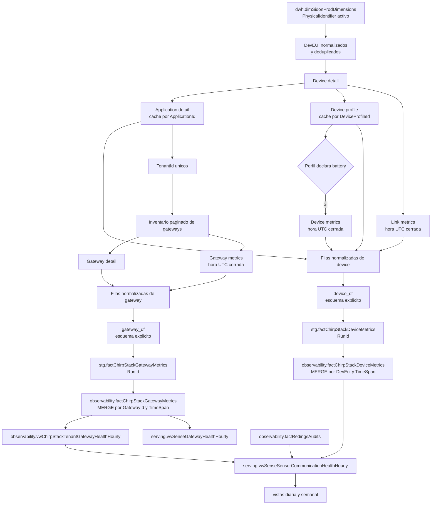

# Pipeline `023_sense_chirpstack_metrics`

## Proposito

Materializar evidencia horaria de devices y gateways de ChirpStack para distinguir falta de comunicacion, degradacion del enlace, problemas de gateway y problemas de ingestion hacia DATA.

## User codes

- `carlsjr`
- `emerson`
- `valledelencino`

El code location `bafar` no ejecuta este pipeline y elimina estos contratos durante su inicializacion SQL especifica.

## Entradas

- `dwh.dimSidonProdDimensions.PhysicalIdentifier` como `DevEui`.
- API de devices, aplicaciones, perfiles, link metrics y device metrics de ChirpStack.
- API de inventario, detalle y metricas de gateways de ChirpStack.
- `observability.factRedingsAudits` para la integracion posterior en vistas de serving.

## Salidas

- `observability.factChirpStackDeviceMetrics`.
- `observability.factChirpStackGatewayMetrics`.
- Vistas horarias de comunicacion de sensores y salud de gateways.
- Vistas diaria y semanal de comunicacion de sensores.
- Watermark `factChirpStackMetrics` en `ctl.IngestionControl`.

## Programacion

- Job: `023_sense_chirpstack_metrics`.
- Schedule: `023_sense_chirpstack_metrics_hourly_at_30`, una vez por hora al minuto 30.
- Frecuencia: cada 30 minutos.
- Zona horaria: `America/Ciudad_Juarez`.
- Estado inicial: activo.

## Flujo

1. Calcula la ultima hora UTC cerrada.
2. Lee dimensiones activas con `PhysicalIdentifier`.
3. Normaliza y deduplica los `DevEui`.
4. Resuelve `ApplicationId`, `DeviceProfileId` y `TenantId` desde ChirpStack.
5. Obtiene uplinks, RSSI, SNR, errores y bateria disponible por device.
6. Obtiene inventario, estado oficial y metricas horarias de gateways por tenant.
7. Construye DataFrames con esquemas explicitos.
8. Escribe ambos hechos en staging por `RunId`.
9. Ejecuta los dos `MERGE` dentro de una misma transaccion.
10. Limpia staging y actualiza el watermark si la corrida termina correctamente.

## Contrato HTTP

Todas las consultas usan `GET`, no envian body y se construyen sobre `CHIRPSTACK_API_URL`. Cada request incluye:

- `Accept: application/json`.
- `Grpc-Metadata-Authorization: Bearer <CHIRPSTACK_API_TOKEN>`.
- timeout configurado mediante `CHIRPSTACK_API_TIMEOUT_SECONDS`.

Las ventanas se expresan en UTC con formato RFC 3339, precision de segundos y sufijo `Z`. Para metricas se envia siempre `aggregation=HOUR`.

## Endpoints consultados

| Endpoint | Proposito | Parametros | Datos consumidos | Destino |
|---|---|---|---|---|
| `GET /api/devices/{devEui}` | Resolver y validar el device asociado con `PhysicalIdentifier` | path: `devEui` normalizado | `devEui`, `applicationId`, `deviceProfileId`, `deviceStatus` | fila de device |
| `GET /api/applications/{applicationId}` | Resolver el tenant del device | path: `applicationId` obtenido del device | `application.id`, `application.tenantId` | fila de device y alcance de gateways |
| `GET /api/device-profiles/{deviceProfileId}` | Obtener la periodicidad esperada y detectar soporte de bateria | path: `deviceProfileId` obtenido del device | `deviceProfile.id`, `tenantId`, `uplinkInterval`, `measurements` | fila de device |
| `GET /api/devices/{devEui}/link-metrics` | Obtener recepcion y calidad del enlace durante la hora cerrada | query: `start`, `end`, `aggregation=HOUR` | timestamps, uplinks, RSSI, SNR y errores | fila de device |
| `GET /api/devices/{devEui}/metrics` | Obtener bateria cuando el perfil declara esa medicion | query: `start`, `end`, `aggregation=HOUR` | serie `battery` | fila de device |
| `GET /api/gateways` | Construir el inventario de gateways de cada tenant descubierto | query: `limit`, `offset`, `tenantId` | `totalCount`, `result`, identidad, tenant, estado y `lastSeenAt` | alcance de gateway |
| `GET /api/gateways/{gatewayId}` | Validar identidad y tenant y obtener configuracion del gateway | path: `gatewayId` obtenido del inventario | `gatewayId`, `tenantId`, nombre y `statsInterval` | fila de gateway |
| `GET /api/gateways/{gatewayId}/metrics` | Obtener actividad RX/TX y resultados de transmision durante la hora cerrada | query: `start`, `end`, `aggregation=HOUR` | timestamps, paquetes RX/TX y estados TX | fila de gateway |

No se consulta `GET /api/devices` para formar el inventario: el alcance de devices proviene de `dwh.dimSidonProdDimensions`. Tampoco se consulta un listado de tenants: cada `TenantId` se obtiene y valida mediante la aplicacion y el perfil de los devices activos.

## Ejemplos de requests

Los identificadores son placeholders y la ventana es ilustrativa. El proceso sustituye estos valores con el alcance y la ultima hora UTC cerrada de cada ejecucion.

```http
GET <CHIRPSTACK_API_URL>/api/devices/<devEui>
Accept: application/json
Grpc-Metadata-Authorization: Bearer <CHIRPSTACK_API_TOKEN>
```

```http
GET <CHIRPSTACK_API_URL>/api/devices/<devEui>/link-metrics?start=2026-09-17T10%3A00%3A00Z&end=2026-09-17T11%3A00%3A00Z&aggregation=HOUR
Accept: application/json
Grpc-Metadata-Authorization: Bearer <CHIRPSTACK_API_TOKEN>
```

```http
GET <CHIRPSTACK_API_URL>/api/gateways?limit=<page_size>&offset=0&tenantId=<tenantId>
Accept: application/json
Grpc-Metadata-Authorization: Bearer <CHIRPSTACK_API_TOKEN>
```

```http
GET <CHIRPSTACK_API_URL>/api/gateways/<gatewayId>/metrics?start=2026-09-17T10%3A00%3A00Z&end=2026-09-17T11%3A00%3A00Z&aggregation=HOUR
Accept: application/json
Grpc-Metadata-Authorization: Bearer <CHIRPSTACK_API_TOKEN>
```

`page_size` proviene de `CHIRPSTACK_API_PAGE_SIZE`; no es una constante del pipeline. `offset` comienza en cero y avanza con la cantidad de gateways recibidos hasta completar `totalCount`.

## Recorrido del dato



### Devices

1. La dimension define cuales `DevEui` pertenecen al alcance de DATA.
2. El detalle del device aporta `ApplicationId` y `DeviceProfileId`.
3. La aplicacion y el perfil resuelven y validan `TenantId`; sus respuestas se cachean durante la ejecucion.
4. El perfil aporta `UplinkIntervalSeconds`, del cual se deriva `ExpectedUplinkCount` para la hora.
5. Link metrics aporta `ReceivedUplinkCount`, `AverageRssi`, `AverageSnr` y `LinkErrorCount`.
6. Device metrics se consulta solo cuando `measurements` declara `battery`; el estado actual del device puede complementar la evidencia de bateria.
7. Las respuestas se normalizan en una fila por `(DevEui, TimeSpan)` y se convierten en `device_df` con esquema explicito.
8. Spark escribe staging con `RunId` y SQL Server consolida la fila en el hecho de observabilidad.

### Gateways

1. Los `TenantId` validados en las filas de devices definen el alcance de gateways.
2. El inventario se pagina por tenant y conserva el estado oficial y `lastSeenAt` expuestos por ChirpStack.
3. El detalle valida identidad y tenant y aporta nombre e intervalo de estadisticas.
4. Gateway metrics aporta paquetes recibidos, transmitidos y resultados TX para la hora cerrada.
5. Las respuestas se normalizan en una fila por `(GatewayId, TimeSpan)` y se convierten en `gateway_df` con esquema explicito.
6. Spark escribe staging con el mismo `RunId`; el `MERGE` de devices y gateways se ejecuta en una sola transaccion.

## Validacion de respuestas

- Las respuestas deben ser JSON y su raiz debe ser un objeto.
- Se validan identidad, tenant, tipos, rangos y timestamps de todos los campos consumidos.
- Las series horarias deben mantener alineados timestamps y datasets.
- La paginacion valida `totalCount`, evita paginas vacias prematuras y rechaza cambios del total durante la lectura.
- Un `GatewayId` no puede aparecer duplicado entre tenants dentro de una ejecucion.
- Campos adicionales de ChirpStack se toleran mientras el contrato consumido permanezca valido.
- La ausencia del bucket solicitado se representa con metricas `NULL` y `MetricsAvailable = 0`.

## Idempotencia y calidad del dato

- Las claves naturales son `(DevEui, TimeSpan)` y `(GatewayId, TimeSpan)`.
- Una reejecucion sin bucket no reemplaza evidencia valida ya persistida.
- `NULL` representa falta de evidencia; cero representa una medicion disponible sin paquetes o errores.
- Los campos consumidos se validan por identidad, tipo, rango, timestamp y alineacion de series.
- Una falla de ChirpStack no bloquea `factRedingsAudits`.

## Configuracion

Cada code location usa su propio prefijo:

- `CARLSJR_CHIRPSTACK_*`
- `EMERSON_CHIRPSTACK_*`
- `VALLEDELENCINO_CHIRPSTACK_*`

Los contenedores exponen internamente `CHIRPSTACK_API_URL`, `CHIRPSTACK_API_TOKEN`, `CHIRPSTACK_API_TIMEOUT_SECONDS` y `CHIRPSTACK_API_PAGE_SIZE`. Los valores reales permanecen fuera del repositorio.

## Backfill

El pipeline no implementa backfill. ChirpStack no expone el historico horario requerido para reconstruir de forma confiable periodos anteriores al inicio de esta captura.

## Documentacion relacionada

- [Feature de observabilidad ChirpStack](../features/chirpstack_observability.md).
- [Modelo de datos de observabilidad ChirpStack](../data_model/sense/chirpstack_observability.md).
